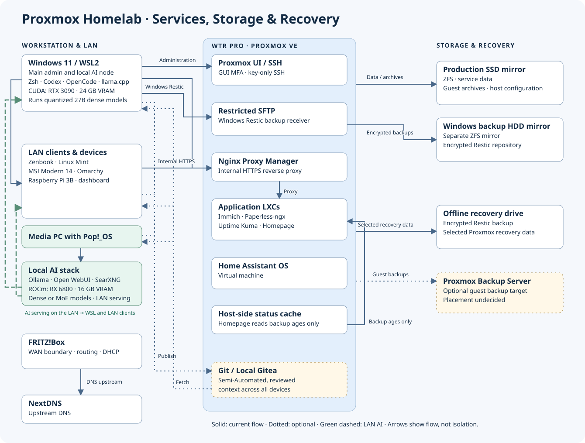

# Proxmox Homelab: Services, Storage & Recovery

This single-node Proxmox lab runs private photo and document services, monitoring, and home automation. I administer it from Windows 11 through WSL2, which also runs local AI workloads. Production data, Windows backups, and offline host recovery each have a separate storage destination.

Solid arrows show current flows. Dotted arrows show optional expansion. Green dashed arrows show the intended LAN AI serving path from the Media PC; that stack is not currently deployed.

## Machines and Roles

| Machine | Role | Status |
| --- | --- | --- |
| Windows 11 workstation / WSL2 | Zsh administration, Codex and OpenCode workflows, and CUDA inference with llama.cpp on an RTX 3090 (24 GB VRAM) | In use |
| WTR Pro / Proxmox VE | Nginx Proxy Manager, Immich, Paperless-ngx, Uptime Kuma, and Homepage in LXCs; Home Assistant OS in a VM | In use |
| Media PC / Pop!_OS | Media and gaming workstation with an RX 6800 (16 GB VRAM) | In use |
| Zenbook / Linux Mint and MSI Modern 14 / Omarchy | Separate Linux workstations for development and experimentation, administered from WSL when needed | In use |
| Raspberry Pi 3B | Lightweight dashboard and LAN device | In use |

The Media PC previously ran a simple LAN AI stack: Ollama for model serving, Open WebUI for browser access, and SearXNG for search. The plan is to bring it back with ROCm as a companion to WSL inference, not a dependency of Proxmox.

## Storage and Recovery

- **Production SSD mirror:** ZFS on two Samsung 870 QVO SSDs stores service data, scheduled guest archives, and host-configuration backups.
- **Windows backup HDD mirror:** Windows runs encrypted Restic backups over restricted SFTP to a separate ZFS mirror. Successful jobs report completion. Homepage reads only cached backup ages, without opening the repositories or waking the HDDs.
- **Removable host recovery:** An encrypted external Restic backup carries selected guest archives, host configuration, and application recovery data. A mirror tolerates a disk failure; the removable copy gives selected data a recovery path outside the host. Both internal mirrors still share the same machine.

Sample restores are verified by comparing SHA-256 hashes with the originals. The dashboard reports backup freshness, not recoverability.

## Administration and Agent Workflow

WSL is the starting point for maintenance. The Zsh workflow is **local-first**: `agentinit` creates a project-local context, `agentreview` reviews proposed shared changes, `agentupdate` promotes them to the local canonical copy, and `agentrefresh` updates another local project. The reduced profile, `agentinit -nosec`, exports an explicit allowlist; it is not a filesystem security boundary.

Git could distribute a deliberately reviewed, reduced context to the other machines. A **planned Gitea instance on Proxmox** would provide a LAN-only remote for that exchange. WSL would publish selected files, and another machine would fetch them explicitly. Neither Gitea nor automatic cross-machine context sync is deployed.

FRITZ!Box handles routing and DHCP; NextDNS is the upstream DNS service. Nginx Proxy Manager routes internal application traffic. Proxmox administration uses key-only SSH and GUI MFA, with no intentional internet port forwarding. LAN-only access does not imply isolation between guests.

Proxmox Backup Server is an optional future guest backup target, not part of the current recovery setup.
