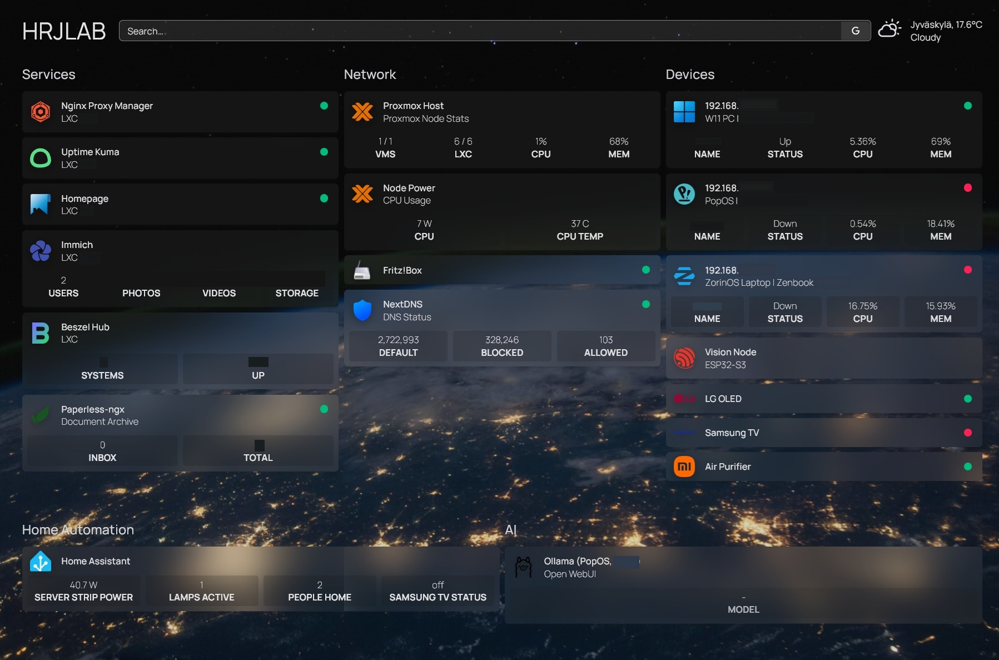

# Proxmox Homelab and Local AI Stack

This repository documents a compact home infrastructure built around Proxmox VE and a separate Pop!_OS workstation for local AI. The goal is a stable internal platform with clear boundaries between storage, virtual machines, containers, and the AI node.

## Purpose

It provides one documented platform for file services, photo management, document handling, monitoring, home automation, and local AI. Instead of several loosely connected machines, the setup behaves like a small internal service environment that is easier to understand, maintain, and extend.

The main design choice is separation of concerns. Core services stay on the Proxmox host, storage stays simple, and AI workloads run on a separate machine so the hypervisor remains focused on infrastructure.

## Architecture

The WTR Pro runs Proxmox VE and hosts the main services as LXC containers together with Home Assistant and Frigate. Storage is a two-disk ZFS mirror on Samsung 870 QVO SSDs. The home LAN is provided by Fritz!Box and NextDNS, and management stays on the internal network.

The separate Pop!_OS media PC serves Gemma 4 through Ollama, Open WebUI, and SearXNG on the LAN. This keeps local AI workloads off the Proxmox host while still making them available across the home network.

## Homepage

## Workstation

The Windows 11 workstation serves as the maintainer console. It uses WSL2 for the agent toolchain, shell automation, and the Proxmox maintenance workflow. A customized agent harness and runbook notes live there for day-to-day management.

## Core Services

The Proxmox host runs Nginx Proxy Manager, Immich, Paperless-ngx, Uptime Kuma, Homepage, and Beszel in LXC containers. Home Assistant runs as VM 150, and Frigate covers the camera and automation side of the stack. The storage layer is a ZFS mirror on two Samsung 870 QVO drives.

The separate Pop!_OS system serves Gemma 4 through Ollama, with Open WebUI and SearXNG as the user-facing layer and search backend.

### Network

- Fritz!Box and NextDNS provide the LAN core
- Proxmox remains LAN-only
- Services are exposed through the internal reverse proxy, not the public internet
