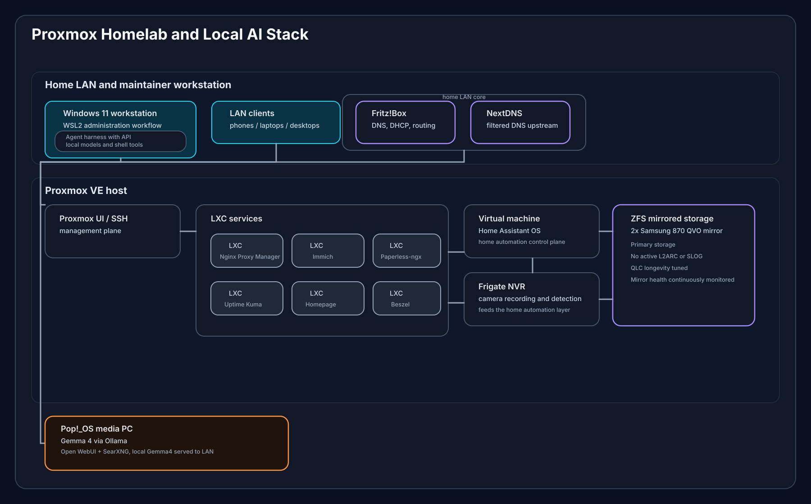

# Proxmox Homelab and Local AI Stack

This project documents a small production homelab centered on a Proxmox VE host and a separate Pop!_OS media workstation for local AI. The design goal is a stable, low-noise home platform with clear service boundaries, simple storage, and maintenance that can be repeated without guesswork.

## Architecture

The WTR Pro runs Proxmox VE and hosts the main services as LXC containers plus Home Assistant and Frigate. Storage is a two-disk ZFS mirror on Samsung 870 QVO SSDs. The home LAN is provided by Fritz!Box and NextDNS, and management stays on the internal network.

The separate Pop!_OS media PC serves Gemma 4 through Ollama, Open WebUI, and SearXNG on the LAN. That keeps local AI workloads off the Proxmox host while still making them available to the home network.

## Homepage

## Workstation

The Windows 11 workstation is the maintainer console. It uses WSL2 for the agent toolchain, shell automation, and the Proxmox maintenance workflow. A customized agent harness and runbook notes live there for day-to-day management.

## What Runs Where

### Proxmox VE host: WTR Pro

- `CT 101`: Nginx Proxy Manager
- `CT 102`: Immich
- `CT 103`: Paperless-ngx
- `CT 110`: Uptime Kuma
- `CT 111`: Homepage
- `CT 113`: Beszel
- `VM 150`: Home Assistant OS
- `Frigate`: NVR layer for camera recording and automation integration
- `Proxmox Backup Server`: planned backup target
- `pool`: ZFS mirror on two Samsung 870 QVO SSDs

### Separate media PC

- Pop!_OS workstation
- Gemma 4 served through Ollama
- Open WebUI exposed on the LAN
- SearXNG for search integration

### Network

- Fritz!Box and NextDNS provide the LAN core
- Proxmox remains LAN-only
- Services are exposed through the internal reverse proxy, not the public internet

## Operational Notes

- Update Proxmox conservatively with `apt dist-upgrade`, then reboot only when the kernel or PVE stack changes.
- Keep the storage layout simple: no active L2ARC or SLOG, only the mirrored QVO pool.
- Apply container updates selectively and keep the stack LAN-only.
